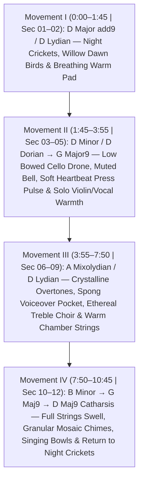

# St. Paul’s Visual Experience — 5-Round Master Content Analysis, Seamless Storyboard Flow, Soundtrack Architecture & Completion Plan

**Project Workspace:** [St_Pauls_Visual_Experience](file:///c:/VV/St_Pauls_Visual_Experience)  
**Live Portal:** `https://videometry.github.io/st-pauls/` *(Password: `peace`)*  
**Target Section Length:** `40s – 60s` per section (`10m 45s` / `645s` complete 12-section show)  
**Target Milestones:** Rough Full-Show Pass (*Before Christmas*) $\rightarrow$ Opening Reveal (*February 12*)

---

## Round 1: Content, Storyboard Fidelity & Narrative Pacing Audit

Comparing the creative meeting direction ([Project_Meeting_and_Creative_Analysis.md](file:///c:/VV/St_Pauls_Visual_Experience/02_Storyboards_and_Production_Guides/Project_Meeting_and_Creative_Analysis.md)) and handwritten storyboard ([Storyboard_and_Projection_Surface_Guide.md](file:///c:/VV/St_Pauls_Visual_Experience/02_Storyboards_and_Production_Guides/Storyboard_and_Projection_Surface_Guide.md)) against our current styleframes, `Veo 3.1` proof-of-concept loops (`SEC01`, `SEC02`, `SEC06`), and v1 scratch audio reveals **four high-impact structural improvements**:

### 1.1 Rebalancing Pacing to Honor the 35/65 Rule (Max 60s Per Section)
* **Finding:** In our v1 10-minute grid, Beat 03 (*Domination*) ran a full `60s` while Beats 06 (*Questioning*), 07 (*Diversity / Spong*), and 08 (*Equality / Women*) were only `45s` each—giving the heavy 19th-century beats `42.5%` of the show.
* **Correction:** Charlie explicitly requested moving **briskly through Beats 3–4** (avoiding a heavy Civil War documentary feel) and **lingering up to a full minute per section in Beats 6–12** where imagination, interfaith questioning, equality, inclusivity, reckoning, and hope expand.
* **New Balanced Runtime (`10:45` total, every section `40s–60s`):**
  * **Act I — Origins, Rupture & Community (`Sections 01–05`):** `3m 55s` (**`36%`**) — `50s`, `55s`, `40s`, `40s`, `50s`.
  * **Act II — Inquiry, Expansion, Reckoning & Transfiguration (`Sections 06–12`):** `6m 50s` (**`64%`**) — `55s`, `60s`, `60s`, `60s`, `60s`, `60s`, `55s`.

### 1.2 Integrating St. Paul’s Own Upstairs Archival RAWs (`A7400361.ARW` – `A7400383.ARW`)
* **Finding:** Our v1 mockups leaned on national public-domain stand-ins where we already own **high-resolution Sony RAW captures shot directly inside St. Paul’s Archives Room**:
  * **Section 03 (*Domination*):** Pair Eyre Crowe’s *Slaves Waiting for Sale* with St. Paul’s own 1865 tall-steeple street captures (`A7400366.ARW`, `A7400369.ARW`) and historical vestry (`A7400363.ARW`).
  * **Section 05 (*Community*):** Feature St. Paul’s actual **Fulton Clinic & parish outreach prints** (`A7400375.ARW`–`A7400383.ARW`) alongside MLK Jr. and Muriel Smith (*The Crowning Experience*).
  * **Sections 06–07 (*Questioning & Spong*):** Feature the joyful **1960s/70s children & youth on St. Paul’s front steps** holding handmade banners with the **Star of David, Menorah, Om, Crescent, Cross**, and *"ST. PAUL’S CHURCH IS LOVE FOR OTHER PEOPLE"* (`A7400367.ARW`–`A7400368.ARW`).
  * **Section 08 (*Equality*):** Feature **Rev. Pat Park** (`A7400373.ARW`–`A7400374.ARW`) and St. Paul’s women leaders (`A7400371.ARW`–`A7400372.ARW`) alongside the Philadelphia Eleven (1974) and Yoko Ono’s *IMAGINE* / *Wish Tree*.
  * **Section 10 (*Truth-Telling*):** Anchor with the team’s own **2020 Monument Avenue projection photography**, **Stations of St. Paul’s 7-panel tree collage mural** (`A7400361.ARW`–`A7400362.ARW`), Hamilton Glass geometry, Kehinde Wiley’s *Rumors of War*, and **Michael Paul Williams** headlines answering **John Mitchell Jr.’s** *Richmond Planet* headlines from Section 04.

### 1.3 Restoring the Storyboard’s Signature Ending (`Butterflies → Pixels → Physical Mosaic → Willow/Stars → Dark`)
* **Finding:** Our v1 Beat 12 ended on floating Yi Peng sky lanterns alone. In the creative meeting, the defining theological climax of the entire work is:
  1. Meditative floating light orbs (`Lights / Buddhist`) release all documentary photography into pure luminous mystery.
  2. A **kaleidoscope of butterflies** fills the ceiling dome, coffered vault, and chancel walls (`Section 11`).
  3. The butterflies **geometricize into glowing square pixels / gold tesserae** that stream down the four Corinthian columns and **lock directly into the physical *Last Supper* gold mosaic (`S1-E`)** above the altar (`Section 12A`).
  4. The **Weeping Willow and Cosmic Stars** from Sections 01–02 shimmer across the columns and dome one final time (`Back to Growth`), while `"PEACE I LEAVE WITH YOU"` glows softly before fading to **Dark** (`Section 12B`).

### 1.4 Weaving the Four Recurring Motifs Continuously Across All 12 Sections
* **`Flowers & Nature`:** Cosmic seed (`01`) $\rightarrow$ Blooming willow, irises & Redouté roses (`02`) $\rightarrow$ Iron winter/withered branches (`03`) $\rightarrow$ Yoko Ono *Wish Tree* & acanthus floral ring (`08`) $\rightarrow$ Floral needlepoint kneelers (`09`) $\rightarrow$ William Morris / Kehinde Wiley botanical reclamation over stone (`10`) $\rightarrow$ Monarch butterflies & final willow shimmer (`11–12`).
* **`Words`:** *Richmond Planet* letterpress headlines (`04`) $\rightarrow$Cascading Hebrew Tetragrammaton `יהוה` (`06–07`) $\rightarrow$ `IMAGINE` & ordination typography (`08`) $\rightarrow$ AIDS Quilt stitched names (`09`) $\rightarrow$ Michael Paul Williams *Times-Dispatch* columns & protest calligraphy (`10`) $\rightarrow$ `"PEACE I LEAVE WITH YOU"` frieze (`12`).

---

## Round 2: Visual Continuity & Seamless Section-to-Section Flow ("Shared Bridge Keyframes")

> [!IMPORTANT]
> **Why Isolated Loops Feel Choppy — and How We Eliminate Cuts Entirely:**  
> Up to now, `SEC01`, `SEC02`, and `SEC06` were generated as closed 4-clip loops (`S1 → S2 → S3 → S4 → S1`). If you string closed loops together, every section change requires either a hard cut or a muddy crossfade.  
> **The Solution:** Replace isolated loops with a **Continuous Shared Bridge Keyframe Chain (`B00` through `B12`)** across all 5 outputs simultaneously.

### 2.1 The 13 Shared Bridge Keyframe Chain (`B00` $\rightarrow$ `B12`, where `B00 == B12`)
Every section (`40s–60s` = `5` to `8` consecutive `Veo 3.1` segments trimmed via `VV Flow Long Loop Assembler`) **begins on the exact ending Bridge Keyframe (`B_{k-1}`) of the previous section** and **ends on the exact starting Bridge Keyframe (`B_k`) of the next section**:

* **Zero Seam Jumps:** Because `Clip_Last` of Section $k$ targets `B_k` as its **End Frame** and `Clip_First` of Section $k+1$ uses the exact same `B_k` PNG as its **Start Frame**, `VV Flow Long Loop Assembler` locks the section boundary at **`96%–98%` pixel similarity** with **zero crossfade blur** on the plaster ribs or Corinthian columns.
* **Modular Re-Rendering:** Because the 13 `Bridge Keyframes` (`B00`–`B12`) act as fixed architectural bulkheads, we can revise or re-render *any single section* later without breaking its seamless entry or exit into neighboring sections!

### 2.2 Spatial Choreography & Directional Handoffs Across the 5 Outputs
To make the whole sanctuary feel like **one breathing organism** rather than 5 separate screens repeating the same motion, every transition has a **spatial travel vector** across Outputs 1–5:

| Spatial Vector | Direction Across the 5 Projector Outputs | Sections Using This Flow |
| :--- | :--- | :--- |
| **1. Rising Earth-to-Sky** | Starts at Altar & Communion Rail (`Output 4`) $\rightarrow$ climbs all 4 Columns (`Outputs 3, 4, 5`) $\rightarrow$ crosses `"PEACE"` Frieze into 9 Vault Coffers (`Output 2`) $\rightarrow$ crowns Nave Medallion (`Output 1`). | **Sec 01 $\rightarrow$ 02** (*Roots to Willow Canopy*), **Sec 09 $\rightarrow$ 10** (*Monument Pedestal to Vault*) |
| **2. Descending Heaven-to-Sanctuary** | Ignites at Tetragrammaton Gold Triangle (`Output 1`) $\rightarrow$ cascades down through 9 Vault Skylights (`Output 2`) $\rightarrow$ washes down the 3 Stained-Glass Arches (`Outputs 3, 4, 5`). | **Sec 05 $\rightarrow$ 06 $\rightarrow$ 07** (*Sacred Triangle & Hebrew Letters*), **Sec 11 $\rightarrow$ 12** (*Butterflies $\rightarrow$ Pixels $\rightarrow$ Altar Mosaic*) |
| **3. Lateral Fracture & Mending** | Sharp vertical division splits Left (`Output 3`) from Right (`Output 5`) across Center (`Output 4`) and isolates the 9 Vault Coffers (`Output 2`), then warm golden light bridges horizontally across all 3 wall bays. | **Sec 03 $\rightarrow$ 04 $\rightarrow$ 05** (*Segregation Split $\rightarrow$ Richmond Planet $\rightarrow$ Community Bridge*) |
| **4. Concentric Ripple & Weave** | Circular motion rotates around the 20 Medallion Coffers (`Output 1`), weaves panel-by-panel across the 8 Perimeter + 1 Center Vault Coffers (`Output 2`), and frames the Wall Bays (`Outputs 3–5`). | **Sec 07 $\rightarrow$ 08 $\rightarrow$ 09** (*Interfaith Wheel $\rightarrow$ `IMAGINE` Medallion $\rightarrow$ Needlepoint/AIDS Quilt*) |

---

## Round 3: Cohesive Soundtrack & Musical Flow Architecture

> [!WARNING]
> **Fixing the v1 Scratch Audio Issue:**  
> Our v1 scratch track crossfaded 12 unrelated public-domain tracks in clashing keys and genres (e.g., raw typewriter clatter in Beat 4, *Go Down Moses* stacked on Bach E-Major violin in Beat 5, Renaissance choir in Beat 8). In the meeting, Charlie emphasized that switching genres every 60 seconds feels jarring—the show needs **one cohesive, continuous ambient "sound wash"** (inspired by **Caroline Shaw’s** modern vocal/string textures) where historical textures rise and dissolve gently inside a unified harmonic key.

### 3.1 Unified 4-Movement Harmonic Spine (`D Центered Modal Arc @ 60 BPM`)
By anchoring the entire `10m 45s` score to a **continuous `D` tonal center** (`60 BPM` = `1 beat per second`, so every `5s`, `8s`, `40s`, `55s`, and `60s` visual milestone lands cleanly on a musical bar!), every transition glides harmonically without pitch clashes:

### 3.2 The "10-Second Overlap Rule" (`-5s Pre-Echo` / `+5s Decay Tail`)
To make sections flow smoothly into and out of one another:
1. **Continuous Drone/Pad Sub-Layer (Never Cuts):** A warm, slow-evolving harmonic bed (`D2–A2–D3` + modal upper extensions) spans all `645 seconds` uninterrupted.
2. **`-5s` Sonic Pre-Echo (Anticipation):** Before any visual `Bridge Keyframe` arrives, the *next* section’s signature sonic texture fades in `5 seconds early` (e.g., dawn birdsong begins softly at `00:45` while Section 01’s cosmic starlight is coalescing into the golden seed on the altar at `00:50`; a single resonant cathedral bell strikes at `03:50` just before the Tetragrammaton triangle ignites at `03:55`).
3. **`+5s` Harmonic Decay Tail:** The outgoing section’s overtones ring out through lush sanctuary reverb `5 seconds into` the new section, eliminating abrupt 60-second "track changes."
4. **Dual-Deliverable Ready:** Exporting the **Continuous Ambient Pad + Nature/Harmonic Stems** without the mid-show percussive/archival accents immediately yields Charlie’s **Sunday Morning Worship "Sound Wash"**!

---

## Round 4: Technical Production Pipeline (Hybrid `Veo 3.1` + Crisp Archival Layering)

To achieve both **fluid organic beauty** and **100% authentic historical portraits/headlines** across `40s–60s` sections, we use a **Two-Layer Hybrid Pipeline**:

### 4.1 Layer 1 — Continuous `Veo 3.1` + `VV Loop Assembler` Living Architectural Base
* Each section (`40s–60s`) is built from **`5` to `8` sequential keyframes** (`B_{k-1} → S1 → S2 → ... → B_k`) per zone (`Zone 2 Medallion`, `Zone 3 Far Vault`, `Zone 1 Chancel`), generated in Google Flow (`Veo 3.1 - Fast`) and trimmed/stitched at exact frame matches (`96%+ PASS`) via `VV Flow Long Loop Assembler`.
* **Pure Environmental Sections (`Sec 01 Creation`, `Sec 02 Blooming Botanical`, `Sec 06 Questioning`, `Sec 11 Butterflies`, `Sec 12 Mosaic & Close`):** Driven `95%–100%` by Layer 1 `Veo 3.1` transformations because organic nebulae, blooming flowers, sacred light rays, butterflies, and mosaic pixels are `Veo 3.1`’s superpower.

### 4.2 Layer 2 — Alpha-Masked Archival & Typographic Compositing (Zero AI Face/Text Warping)
* **Historical & Typographic Sections (`Sec 03, 04, 05, 07, 08, 09, 10`):**
  * Layer 1 (`Veo 3.1`) generates the **living architectural environment** (e.g., charcoal stone & ember smoke in `Sec 03`; sharp light/shadow split & warm letterpress glow in `Sec 04`; stitched quilt fabric & Keith Haring kinetic border lines in `Sec 09`; graffiti-textured columns & blooming William Morris vines in `Sec 10`).
  * Layer 2 composites **high-resolution, un-warped archival photography and crisp kinetic typography** strictly inside our pre-cut architectural alpha masks ([01_Projection_Templates_For_Animation](file:///c:/VV/St_Pauls_Visual_Experience/01_Projection_Templates_For_Animation) — `Upper Smooth Plaster Wall Bays S1-C`, `Lower Framed Dado Panels S1-D`, and `Vault Coffer Recesses S2-B/C`) with feathered projection falloff, subtle Ken Burns drift, and raking surface shadows!
  * **Why This Wins:** Human faces (Bishop Spong, Rev. Pat Park, MLK Jr., Mary Wingfield Scott, Eyre Crowe’s figures) and newspaper headlines (*The Richmond Planet*, *Times-Dispatch*) remain **100% historically faithful and razor-sharp**, while the sanctuary around them breathes with continuous `Veo 3.1` projection light.

### 4.3 Resolution & Playback Outputs
* **5 Synchronized Master Deliverables per Section (or Full `10:45` Show):**
  1. `Output 1 (Zone 2 Medallion)`: `1920×1080` (`16:9`)
  2. `Output 2 (Zone 3 Far Ceiling Vault)`: `1920×1080` (`16:9` un-stretched)
  3. `Output 3 (Zone 1A Left Chancel Bay)`: `1080×1920` (`9:16`)
  4. `Output 4 (Zone 1B Center Altar Bay)`: `1080×1920` (`9:16`)
  5. `Output 5 (Zone 1C Right Chancel Bay)`: `1080×1920` (`9:16`)
* **Client Approval Deliverable:** `1080×1920` (`9:16`) **Unified 5-Output Sanctuary Visualizer MP4** with 48kHz Stereo Soundtrack baked in.

---

## Round 5: Complete 12-Section Master Blueprint, Transition Matrix & Production Roadmap

### 5.1 Master 12-Section Storyboard, Flow & Soundtrack Matrix (`00:00` – `10:45`)

| Sec | Timecode & Dur | Section Title & Core Visuals | Entry Bridge (`B_{k-1}`) $\rightarrow$ Internal Flow $\rightarrow$ Exit Bridge (`B_k`) | Spatial Vector (Outputs 1–5) | Continuous Soundtrack (`D` Modal Spine + `-5s/+5s` Bridges) | Current Status |
| :--- | :--- | :--- | :--- | :--- | :--- | :--- |
| **01** | `00:00–00:50` **`50s`** *(6–7 clips)* | **Creation: Cosmic Spark & Starlight** *(JWST nebula, golden architecture trace, primordial harmony)* | **`B00` (Darkness + faint altar spark)** $\rightarrow$ golden wireframe traces columns & dome $\rightarrow$ indigo/gold Carina nebula fills arches & coffers $\rightarrow$ **`B01` (Starlight coalesces into glowing emerald/gold seed at altar & dome rings)** | **Bottom-Up:** Altar (`Out 4`) $\rightarrow$ Columns (`Out 3–5`) $\rightarrow$ Vault (`Out 2`) $\rightarrow$ Dome (`Out 1`) | **D Maj9 Pad + Night Crickets & Frogs.** At `00:45` (`-5s`), distant dawn willow birdsong fades in. | ✅ **v1 Built (`45s`)** *(Needs `B01` exit bridge & v2 continuous audio)* |
| **02** | `00:50–01:45` **`55s`** *(7 clips)* | **Growth: Weeping Willow & Blooming Flowers** *(Willow canopy, Tiffany irises/magnolias, Redouté roses)* | **`B01` (Emerald/gold seed)** $\rightarrow$ willow roots/vines climb 4 columns $\rightarrow$ Tiffany irises & willow canopy open $\rightarrow$ full pink Redouté rose & millefleurs bloom $\rightarrow$ **`B02` (Sunlit willow canopy slowly desaturating into twilight amber)** | **Bottom-Up & Radial Bloom:** Columns (`Out 3–5`) spill willow fronds across Frieze (`Out 2`) into 20 Dome Coffers (`Out 1`) | **D Lydian Warmth + Dawn Chorus & Nightingale.** At `01:40` (`-5s`), birdsong recedes as low bowed `D2` cello enters. | ✅ **v1 Built (`45s`)** *(Needs `B01/B02` bridges & v2 continuous audio)* |
| **03** | `01:45–02:25` **`40s`** *(5 clips)* | **Domination: Iron, Steeple & Human Dignity** *(1865 tall steeple `A7400366`, Eyre Crowe paintings, stone/iron)* | **`B02` (Twilight willow)** $\rightarrow$ leaves blow away as vines petrify into stark charcoal stone & iron bars $\rightarrow$ 1865 tall steeple in Center (`Out 4`) + Eyre Crowe humanistic portraits on Left/Right walls (`Out 3,5`) $\rightarrow$ **`B03` (Monochrome architectural shadow)** | **Compression:** Cold shadow closes inward; Dome (`Out 1`) ticks slowly across 20 coffers | **D Minor / Dorian Pivot.** Bowed contrabass drone + single solemn muffled bell + subtle wind texture. | 🔲 **To Build** *(Hybrid: Veo stone/iron + masked Crowe & `A7400366`)* |
| **04** | `02:25–03:05` **`40s`** *(5 clips)* | **Separation: Divided Light & *The Richmond Planet*** *(Stark split + John Mitchell Jr. bold headlines)* | **`B03` (Monochrome stone)** $\rightarrow$ sharp white vertical barrier lines divide the 4 columns & 9 coffers $\rightarrow$ warm amber letterpress plates of *The Richmond Planet* stamp & illuminate the walls, defying division $\rightarrow$ **`B04` (Amber newsprint glow melting the dividing lines)** | **Lateral Split $\rightarrow$ Type Illumination:** Left/Right split (`Out 3/5`) broken by bold headlines in `Out 2, 3, 5` | **D Dorian Pulse.** Subtle, musicalized felt-mallet / letterpress heartbeat (`60 BPM`) beneath brooding strings. | 🔲 **To Build** *(Hybrid: Veo split light + crisp *Richmond Planet* plates)* |
| **05** | `03:05–03:55` **`50s`** *(6–7 clips)* | **Community: Fulton Clinic, Muriel Smith & Civil Rights** *(St. Paul’s `A7400375–383`, MLK Jr., Technicolor warmth)* | **`B04` (Melting amber lines)** $\rightarrow$ warm golden bridges link all 3 wall bays $\rightarrow$ Fulton Clinic outreach photos, MLK Jr., & warm Technicolor light fill plaster bays & 9 coffers $\rightarrow$ **`B05` (Sanctuary bathed in upward-looking candlelit gold)** | **Horizontal Bridge $\rightarrow$ Upward Gaze:** Light joins `Out 3–5`, crowns `"PEACE"` Frieze (`Out 2`), & points to Dome (`Out 1`) | **Warm G Maj9 $\rightarrow$ D Maj Resolution.** Solo lyrical violin & humming vocal pad (Caroline Shaw style). Bell pre-echo at `03:50`. | 🔲 **To Build** *(Hybrid: Veo golden bridge + Fulton Clinic RAWs)* |
| **06** | `03:55–04:50` **`55s`** *(7 clips)* | **Questioning: Sacred Tetragrammaton & Inquiry** *(Dome Gold Triangle `יהוה`, sapphire chiaroscuro, Hebrew letters)* | **`B05` (Candlelit gold)** $\rightarrow$ room dims to deep sapphire chiaroscuro as **Center Gold Triangle (`Out 1`)** ignites $\rightarrow$ glowing Hebrew letters & sacred geometry rays cascade down through Vault (`Out 2`) into Chancel (`Out 3–5`) $\rightarrow$ **`B06` (Radiant triangle & sapphire-gold rays)** | **Top-Down Revelation:** Apex of Medallion (`Out 1`) $\rightarrow$ Far Vault (`Out 2`) $\rightarrow$ Chancel Arches (`Out 3–5`) | **A Mixolydian / Crystalline Overtones.** Shimmering glass/harp harmonics & contemplative cathedral pad. | ✅ **v1 Built (`45s`)** *(Needs `B05/B06` bridges & cascading Hebrew script)* |
| **07** | `04:50–05:50` **`60s`** *(8 clips)* | **Diversity: Bishop Spong & Interfaith Welcome** *(Spong portraits/audio, 60s/70s step banners `A7400368`, interfaith wheel)* | **`B06` (Sapphire-gold rays)** $\rightarrow$ Gold Triangle expands into a 20-spoke prismatic Interfaith Rose Wheel (`Star of David, Menorah, Om, Crescent, Cross` in `Out 1`) $\rightarrow$ Spong & 1960s/70s `"LOVE FOR OTHER PEOPLE"` children’s banners illuminate `Out 3–5` $\rightarrow$ **`B07` (Warm prismatic stained-glass glow)** | **Concentric Expansion:** 20-coffer Interfaith Wheel (`Out 1`) $\rightarrow$ 9-coffer rose glass (`Out 2`) $\rightarrow$ Chancel bays (`Out 3–5`) | **Warm Open-Fifth Ambient Wash** with `300Hz–3kHz` EQ pocket reserved for reverberant **Bishop Spong lecture soundbites**. | 🔲 **To Build** *(Partially in `SP_LOOP_01`; expand to full 5-output `60s`)* |
| **08** | `05:50–06:50` **`60s`** *(8 clips)* | **Equality: Women’s Leadership & `IMAGINE`** *(Rev. Pat Park `A7400374`, Philadelphia Eleven, Yoko Ono *Wish Tree* / `IMAGINE`)* | **`B07` (Prismatic glow)** $\rightarrow$ shifts into luminous ordination white, suffragette violet & gold $\rightarrow$ `IMAGINE` mosaic & blooming acanthus floral ring in `Out 1` + Philadelphia Eleven & Rev. Pat Park in `Out 2–5` $\rightarrow$ **`B08` (Radiant violet/gold floral threads)** | **Floral & Typographic Rise:** Acanthus ring blooms (`Out 1`) while clean architectural frames honor women leaders (`Out 2–5`) | **D Lydian Soaring Treble Vocal/Choral Pad.** Ethereal treble voices (wordless *Cantate* / Shaw texture) lifting upward. | 🔲 **To Build** *(Partially in `SP_LOOP_02`; expand with `A7400374` & Philly 11)* |
| **09** | `06:50–07:50` **`60s`** *(8 clips)* | **Inclusivity: LGBTQ+ Love, Haring Line & Needlepoint/AIDS Quilt** *(Mary Wingfield Scott, kneeler tapestry, quilt)* | **`B08` (Floral threads)** $\rightarrow$ threads literally stitch the **9 Vault Coffers (`Out 2`)** into a living patchwork of St. Paul’s needlepoint kneelers & AIDS Memorial Quilt $\rightarrow$ Keith Haring-inspired kinetic line hearts dance around `Out 1` border; 1930s family & marriage equality in `Out 3–5` $\rightarrow$ **`B09` (Woven golden/colorful tapestry)** | **Overhead Quilt Canopy:** `Out 2` 9-coffer quilt grid & `Out 1` kinetic border embrace intimate portraits on `Out 3–5` | **Tender, Joyful Chamber Strings & Warm Pulse.** Plucked harp/strings & warm cello melody over continuous `D` pad. | 🔲 **To Build** *(Partially in `SP_LOOP_02/04/05`; unify + add archival layer)* |
| **10** | `07:50–08:50` **`60s`** *(8 clips)* | **Truth-Telling & Reckoning: 2020 Projections, MP Williams & Botanical Healing** *(Monument projections, `A7400362`, Morris/Wiley flora)* | **`B09` (Woven tapestry)** $\rightarrow$ bursts into vibrant street-art/Hamilton Glass geometry & **2020 Monument Avenue projection light** on Center (`Out 4`), flanked by *Rumors of War*, Stations mural (`A7400362`) & **MP Williams headlines** (echoing Sec 04!) as lush William Morris botanicals heal the walls $\rightarrow$ **`B10` (Cathartic golden light & floating blossoms)** | **Full-Room Crescendo:** Ground-up projection energy from Altar/Columns (`Out 3–5`) surges across Vault & Dome (`Out 2, 1`) | **Emotional Dynamic Peak (`B Min → G Maj9 → D Maj9`).** Full cathartic string swell (*Amazing Grace* harmonic contour re-voiced into ambient strings). | 🔲 **To Build** *(Combine team’s 2020 Monument photos + `A7400362` + Morris flora)* |
| **11** | `08:50–09:50` **`60s`** *(8 clips)* | **Hope & Possibility: Meditative Lights & Kaleidoscope of Butterflies** *(Buddhist/floating orbs $\rightarrow$ hundreds of butterflies)* | **`B10` (Golden light & blossoms)** $\rightarrow$ all literal historical imagery dissolves into serene floating light orbs (`Lights / Buddhist`) $\rightarrow$ blossoms take wing as hundreds of luminous Monarch & Swallowtail butterflies swirling from Dome (`Out 1`) across Vault (`Out 2`) and Chancel (`Out 3–5`) $\rightarrow$ **`B11` (Swirling golden butterflies beginning to crystallize)** | **3D Sanctuary Flight:** Butterflies launch from Medallion (`Out 1`), cross Vault skylights (`Out 2`), and fill Chancel (`Out 3–5`) | **Transcendent Overtone Wash.** Strings release into shimmering high harmonic overtones, bowed singing bowls, and gentle air. | 🔲 **To Build** *(Expand `SP_LOOP_02/04/06` butterfly motifs into dedicated 5-output flight)* |
| **12** | `09:50–10:45` **`55s`** *(7 clips)* | **The Close: Pixels into *Last Supper* Mosaic, Return to Willow/Stars & Dark** *(Butterflies $\rightarrow$ pixels $\rightarrow$ mosaic tiles $\rightarrow$ willow/stars $\rightarrow$ dark)* | **`B11` (Crystallizing butterflies)** $\rightarrow$ butterflies geometricize into glowing square gold pixels/tesserae streaming down the 4 columns and **locking into the physical *Last Supper* Mosaic (`Out 4`)** $\rightarrow$ brief final shimmer of **Weeping Willow & Stars** (`Back to Growth`) + `"PEACE I LEAVE WITH YOU"` frieze (`Out 2`) $\rightarrow$ **`B12 == B00` (Slow fade to Dark + single warm spark)** | **Convergence to Altar Mosaic:** `Out 1 & 2` $\rightarrow$ `Out 3 & 5` columns $\rightarrow$ **Center Tiffany Mosaic (`Out 4`)** $\rightarrow$ Gentle fade to Dark | **Granular Mosaic Chimes $\rightarrow$ Singing Bowl `D` Drone $\rightarrow$ Quiet Night Crickets & Breeze** fading to peaceful silence at `10:45`. | 🔲 **To Build** *(Signature pixels-to-mosaic convergence + willow return)* |

---

### 5.2 Concrete 4-Phase Execution Plan to Reach a Complete Show

To build this cleanly without rework—and keep every milestone viewable on `https://videometry.github.io/st-pauls/` in our **`9:16` 5-Output Unified Sanctuary Visualizer**—we execute in **4 structured phases**:

1. **Phase A — Lock the Backbone First: Continuous `10:45` Master Soundtrack v2 & All 13 Shared Bridge Keyframes (`B00`–`B12`)**
   * **Deliverable A1 (Audio Spine):** Build the unified `10m 45s` **D-Modal Continuous Ambient Soundtrack v2** (with `-5s/+5s` transition overlaps, musicalized pulses, Caroline Shaw-inspired vocal/string pads, and nature bookends) + export the 12 overlapping section stems (`Sec_01`–`Sec_12`).
   * **Deliverable A2 (Visual Bulkheads):** Generate and review a **Master 13-Bridge Contact Sheet** (`13 Bridges × 3 Zones = 39 Master Bridge PNGs`) + processed high-res cutouts of St. Paul’s upstairs `.ARW` archival photos (`A7400361`–`A7400383`). Once `B00`–`B12` look cohesive side-by-side, seamless section-to-section flow is **guaranteed before we render a single new video clip**.
2. **Phase B — Act I Continuous Flow (`Sections 01–05`, `00:00 – 03:55`)**
   * Upgrade `Sec 01 (Creation, 50s)` and `Sec 02 (Blooming Botanical, 55s)` to chain cleanly through `B00 → B01 → B02`, and produce `Sec 03 (Domination, 40s)`, `Sec 04 (Separation / Richmond Planet, 40s)`, and `Sec 05 (Community / Fulton Clinic, 50s)` using the Hybrid `Veo 3.1` + Alpha-Masked Archival pipeline.
   * Render a continuous **`3m 55s` Act I 5-Output Unified Sanctuary Reel** to verify every single section-to-section transition in motion with the v2 soundtrack.
3. **Phase C — Act II Expansion & Reckoning (`Sections 06–10`, `03:55 – 08:50`)**
   * Upgrade `Sec 06 (Questioning, 55s)` (`B05 → B06`) and produce `Sec 07 (Spong & Interfaith, 60s)`, `Sec 08 (Women’s Equality & IMAGINE, 60s)`, `Sec 09 (Inclusivity, Haring & Needlepoint/AIDS Quilt, 60s)`, and `Sec 10 (2020 Monument Projections, MP Williams & Botanical Healing, 60s)`.
4. **Phase D — Transfiguration Climax & Full `10:45` Master Assembly (`Sections 11–12` + Final 5-Output Deliverables)**
   * Produce `Sec 11 (Meditative Lights & Kaleidoscope of Butterflies, 60s)` and `Sec 12 (Butterflies → Pixels → Last Supper Mosaic → Return to Willow/Stars → Fade to Dark, 55s)`.
   * Concatenate all 12 seamlessly bridged sections into:
     * The **Complete `10:45` (`9:16` `1080×1920`) 5-Output Unified Sanctuary Master Film** (with Stereo Audio) for Charlie & Anne’s review,
     * The **5 Individual `1080p` Synchronized Projector Show Reels** (`Output 1`–`Output 5`) + **Sunday Morning Ambient Sound/Light Wash Edition**.
